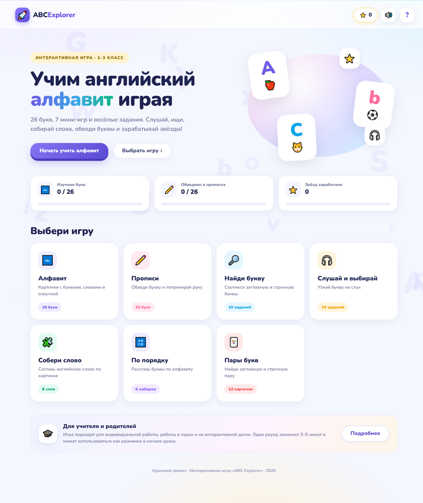
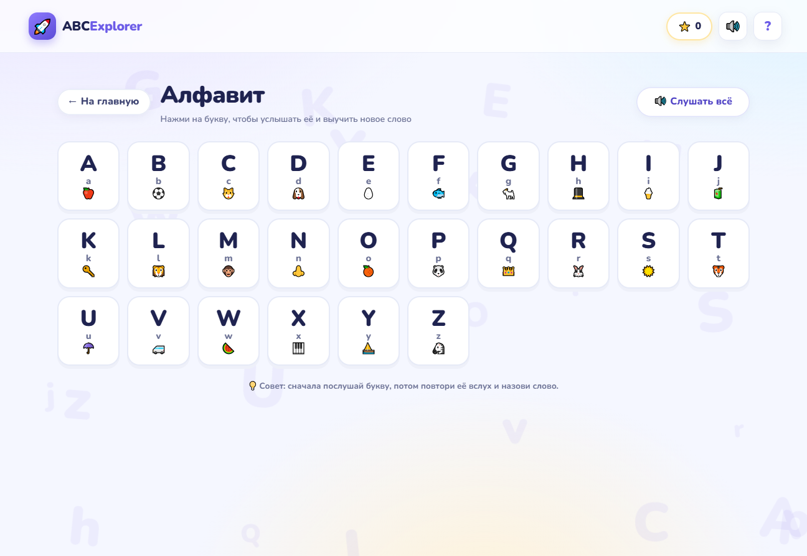
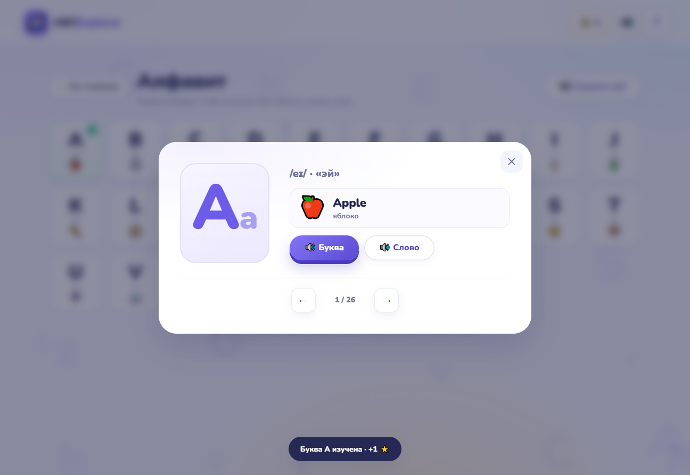
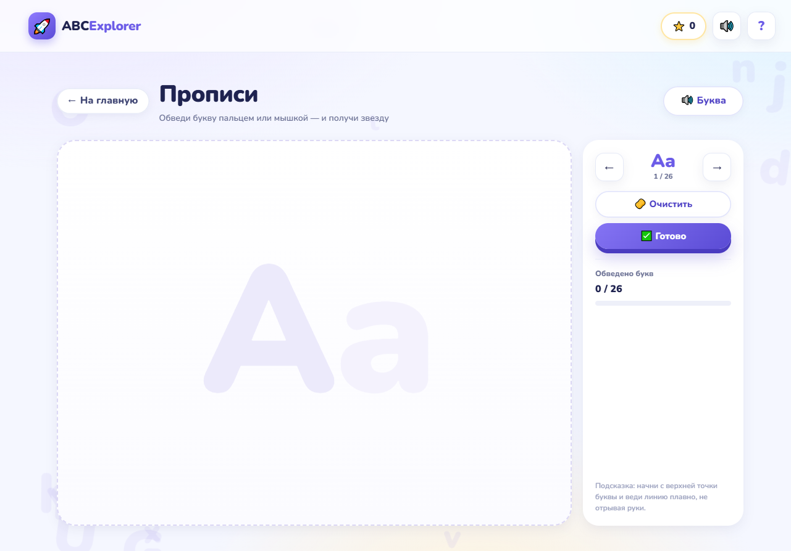
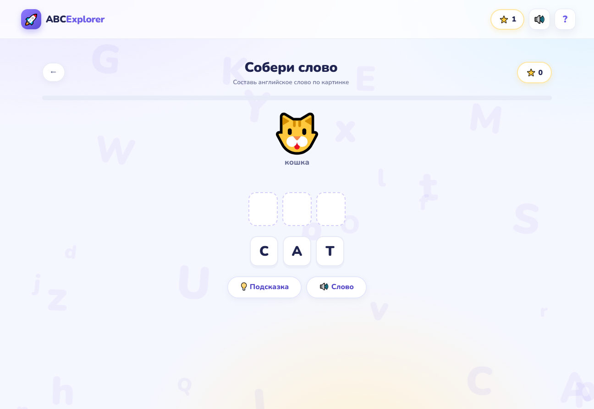

# ABC Explorer

**Интерактивная игра для изучения английского алфавита в начальной школе**

Курсовой проект. Представляет собой готовый веб-сайт (SPA) на чистом HTML, CSS и JavaScript — без сборки, зависимостей и сторонних библиотек.

---

## Быстрый запуск

**Способ 1 — просто открыть файл**

Откройте `index.html` двойным щелчком. Игра работает прямо из файловой системы.

**Способ 2 — локальный сервер (рекомендуется)**

Так стабильнее работают звук, озвучка и сохранение прогресса:

```bash
# если установлен Python
python -m http.server 8000

# если установлен Node.js
npx serve .
```

Затем откройте `http://localhost:8000`.

> Для озвучки нужен английский голос в системе (Windows: «Параметры → Время и язык → Речь»). Если голоса нет, игра продолжает работать, но произношение букв будет недоступно.

---

## Скриншоты

| Главный экран | Алфавит |
|---|---|
|  |  |

| Карточка буквы | Прописи |
|---|---|
|  |  |



---

## Что умеет игра

| Режим | Что тренирует | Механика |
|---|---|---|
| **Алфавит** 🔤 | Узнавание букв, словарный запас | 26 карточек: буква, транскрипция, слово, картинка, озвучка |
| **Прописи** ✏️ | Мелкая моторика, начертание букв | Обведение заглавной и строчной буквы на canvas мышью или пальцем |
| **Найди букву** 🔎 | Соотнесение заглавной и строчной букв | 10 заданий, варианты-ловушки (`b/d/p/q`, `m/n/u/w`, `i/j/l`) |
| **Слушай и выбирай** 🎧 | Фонематический слух | 10 заданий: услышать букву и выбрать её из похожих по звучанию |
| **Собери слово** 🧩 | Чтение, составление слов | 8 слов: собрать слово из букв по картинке и переводу |
| **По порядку** 🔠 | Знание алфавитной последовательности | 6 наборов по 5 букв: расставить по алфавиту |
| **Пары букв** 🃏 | Память, внимание | 12 карточек: найти пары «заглавная — строчная» |

Дополнительно:

- ⭐ **Звёзды** за изученные буквы, прописи и игры.
- 📊 **Прогресс**: изучено букв, обведено букв, лучший результат в каждой игре.
- 🔊 **Озвучка** букв и слов (Web Speech API, британский английский).
- 🎵 **Звуковые эффекты** и конфетти — без внешних аудиофайлов, генерируются в браузере.
- 💾 **Сохранение прогресса** в `localStorage` (кнопка сброса — в окне «О проекте»).
- 📱 **Адаптивность**: компьютер, планшет, интерактивная доска, телефон.
- 🎓 **Окно «О проекте»** с методической справкой для учителя.

---

## Педагогический замысел

**Цель:** формирование устойчивого навыка узнавания букв английского алфавита (заглавных и строчных), соотнесения буквы со звуком и словом у учащихся 2–3 классов.

**Задачи, которые решает игра:**

1. Запоминание графического образа 26 букв.
2. Различение похожих по начертанию букв (`b/d`, `p/q`, `m/n`).
3. Развитие фонематического слуха на материале английских букв.
4. Первичное накопление лексики (26 слов с картинками + 20 слов для сборки).
5. Тренировка мелкой моторики и подготовка к письму.
6. Повышение мотивации за счёт игровой формы, мгновенной обратной связи и наград.

**Практическое применение:** разминка в начале урока (3–5 минут), индивидуальная работа, работа в парах за планшетом, фронтальная работа на интерактивной доске, домашняя тренировка.

Подробные рекомендации — в файле [`docs/МЕТОДИЧЕСКИЕ_РЕКОМЕНДАЦИИ.md`](docs/МЕТОДИЧЕСКИЕ_РЕКОМЕНДАЦИИ.md).

---

## Техническая реализация

- **HTML5** — семантическая разметка, один экран приложения и модальные окна.
- **CSS3** — собственная дизайн-система: переменные, адаптивная сетка, анимации, 3D-переворот карточек, `prefers-reduced-motion`.
- **JavaScript (ES6)** — модульная структура на глобальном пространстве `window.ABC`, без сборщика.
- **Web Speech API** — произношение букв и слов на английском (`en-GB`).
- **Web Audio API** — синтез звуковых эффектов (правильно/ошибка/победа).
- **Canvas 2D** — прописи с поддержкой мыши, пальца и стилуса (`Pointer Events`).
- **localStorage** — сохранение звёзд, изученных букв и рекордов.

### Структура проекта

```
PPDan/
├── index.html                 # разметка всех экранов
├── css/
│   └── styles.css             # дизайн-система и адаптивность
├── js/
│   ├── data.js                # буквы, слова, похожие буквы, список режимов
│   ├── core.js                # утилиты, прогресс, озвучка, звуки, конфетти
│   ├── screens.js             # главная, алфавит, карточка буквы, оболочка игр
│   ├── trace.js               # прописи (canvas)
│   ├── app.js                 # инициализация и навигация
│   └── games/
│       ├── find.js            # «Найди букву»
│       ├── listen.js          # «Слушай и выбирай»
│       ├── word.js            # «Собери слово»
│       ├── order.js           # «По порядку»
│       └── memory.js          # «Пары букв»
├── docs/
│   ├── МЕТОДИЧЕСКИЕ_РЕКОМЕНДАЦИИ.md
│   └── screenshots/           # скриншоты для пояснительной записки
└── README.md
```

### Как добавить новую букву или слово

Все учебные материалы лежат в `js/data.js`:

```js
// буква
{ l: "A", name: "эй", ipa: "/eɪ/", word: "Apple", ru: "яблоко", emoji: "🍎" }

// слово для сборки
{ w: "CAT", ru: "кошка", emoji: "🐱" }
```

Новый режим добавляется в `ABC.GAME_LIST`, логика — в `js/games/`.

---

## Проверочный лист (что протестировано)

- [x] Открытие сайта без сборки, без ошибок в консоли.
- [x] Все 26 карточек алфавита: озвучка буквы и слова, отметка «изучено», звёзды.
- [x] Навигация по карточкам стрелками, закрытие по Esc и клику по фону.
- [x] «Найди букву»: 10 раундов, варианты-ловушки, подсчёт результата.
- [x] «Слушай и выбирай»: автопроизведение, повтор по кнопке, 10 раундов.
- [x] «Собери слово»: слова с повторяющимися буквами (BALL, EGG, MOON), подсказка.
- [x] «По порядку»: 6 наборов, блокировка неверных нажатий.
- [x] «Пары букв»: переворот, совпадения, возврат неверной пары, ходы.
- [x] Прописи: рисование мышью, очистка, звезда за букву, переход к следующей.
- [x] Экран результатов: 1–3 звезды, повтор игры, возврат к играм.
- [x] Сохранение прогресса после перезагрузки, сброс прогресса.
- [x] Адаптивность 390 / 560 / 768 / 1024 / 1296 px — без горизонтальной прокрутки.

---

## Ограничения

- Озвучка зависит от установленных в системе английских голосов и поддерживается не всеми браузерами.
- При открытии через `file://` некоторые браузеры могут блокировать `localStorage` — прогресс сохранится только до перезагрузки (запуск через локальный сервер решает проблему).
- Проект не использует серверную часть: все данные хранятся на устройстве ученика.

---

## Автор

Курсовой проект, 2026 г.
Тема: «Разработка интерактивной игры "Изучение английского алфавита в начальной школе"».
